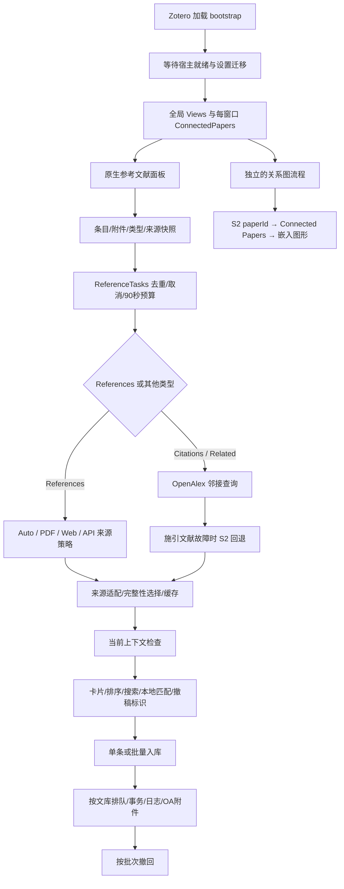

# RefFlow V10 实现逻辑、流程与优化审查

审查日期：2026-10-15。对象：当前 `zotero-reference` 工作目录中的 RefFlow 10.0.0；插件 ID 为 `refflow@groele.github.io`。本轮审查业务代码、配置、构建流程、测试驱动与安装包，新增审查报告和复现脚本，没有修复业务代码或生成新版本。随后实施的 10.1.0 修复见 [修复与验收](REPAIRS-2026-10-15.md)。本报告保留原始 V10 截点的问题和计数，不代表修复后的状态。

**判断：现有基础机制可以保留，但业务链路尚有明显缺口。应先解决条目身份与撤回所有权，再统一完整性、缓存和来源策略，随后处理关系图与性能。** 单元测试通过不能说明这些链路已经正确。

**一、证据与结论边界**

| 检查 | 本轮结果 | 证据 |
|---|---|---|
| 单元测试 | 244/244 通过 | `evidence/audit-2026-10-15/unit.log` |
| TypeScript | `npm run tsc` 通过；构建中再次通过 | `evidence/audit-2026-10-15/build.log` |
| 依赖审计 | `npm audit --json` 报告已知漏洞 0；不代表完整安全证明 | `evidence/audit-2026-10-15/npm-audit.json` |
| 评估构建 | `REFFLOW_NO_PROMOTE=1`，生产模式构建通过 | 同上 |
| XPI 内容校验 | 28 个文件通过；清单、更新哈希一致 | `evidence/audit-2026-10-15/package-verification.json` |
| 原生数据流回归 | 13/13 | `evidence/audit-2026-10-15/native-dataflow.json` |
| 原生结构回归 | 8/8 | `evidence/audit-2026-10-15/native-structure.json` |
| 原生架构回归 | 6/6 | `evidence/audit-2026-10-15/native-architecture.json` |
| 原生预算与持久化回归 | 15/15 | `evidence/audit-2026-10-15/native-pipeline.json` |
| 原生 major 回归 | 11 通过，1 失败；失败为旧版本号断言 | `evidence/audit-2026-10-15/native-major.json` |
| 上述回归合计 | **53/54**；不能记为全部通过 | `evidence/audit-2026-10-15/verification.json` |
| 新增定向复现 | **11 个探针完成：10 个复现缺陷，1 个验证旧响应隔离正确** | `evidence/audit-2026-10-15/native-audit.json` |
| 退役接口专项扫描 | 47 个文件中，指定退役成员/网址命中 0 | `evidence/audit-2026-10-15/interface-audit.json` |
| 无插件启动对照 | 未装 RefFlow 的独立配置无 `uncaught exception: undefined`；有 Zotero streamer 连接错误 | `evidence/audit-2026-10-15/startup-without-plugin.json` |

原生测试使用 Windows / Zotero 10.0.6、独立配置、独立 SQLite 文库、独立 TEMP/TMP。PDF 使用真实 SDT，入库与撤回实际写入独立文库；供应方故障及响应使用受控数据，HTTP 预算专项使用本机回环服务器。本轮没有重新验收 Zotero 11，也没有使用真实 CNKI 账户、Connected Papers 付费账户或完整的实时外部服务矩阵。

11 个探针的“完成”表示复现场景成功执行，**不是 11 项正确性断言通过**。其中 10 个场景明确观察到缺陷。

根目录现有发布包 SHA-256 为 `5ab078db36712efa4d7c48ba858478e3484976511c86ab2e3fa4e1be834d5dfd`。评估包 SHA-256 为 `7841eb53994bdf44144e099a74e2d92fb5c6b9b5556d32ab1cc5d8b9d6877975`。两个 ZIP 的成员内容逐项比较无差异；归档字节哈希不同。根目录发布包及 `update.json` 未被评估构建提升或替换，以上是原始 V10 审查截点的状态；后续 10.1.0 修复见 [修复与验收](REPAIRS-2026-10-15.md)。

**二、整体实现如何组织**



这里有两个不同的产品流程：一是参考文献、施引文献及相关文献列表；二是 Connected Papers 关系图。它们可以共享元数据与本地匹配服务，但图形边的含义不能自动等同于某篇论文的实际引用方向。

| 层次 | 主要文件 | 当前职责 |
|---|---|---|
| 宿主生命周期 | `addon/bootstrap.js`、`src/index.ts`、`src/hooks.ts` | 注册资源、启动、窗口接入、关闭与卸载 |
| 设置与迁移 | `src/utils/identityMigration.ts`、`src/modules/prefs.ts`、`addon/chrome/content/scripts/preferences.js` | 旧设置复制、设置页挂载及清理 |
| 用例协调 | `src/modules/views.ts` | 来源路由、上下文快照、缓存调用、界面提交 |
| 刷新任务 | `referenceTasks.ts`、`operationBudget.ts` | 任务去重、取消、总预算与子预算 |
| 来源接入 | `api.ts`、`openalex.ts`、`semanticScholar.ts`、`publisherReferences.ts` | 查询、转换、分页、补全和回退 |
| 本地提取 | `pdf.ts`、`structuredPDF.ts`、`pdfLayout.ts`、`referenceExtractor.ts`、`parsers/gbt7714.ts` | SDT、阅读顺序、条目边界、引文解析 |
| 结果契约 | `referenceData.ts`、`referenceRetrieval.ts`、`referenceCache.ts` | 纯数据、完整性、列表选择、缓存快照 |
| 网络与磁盘 | `requests.ts`、`localStorage.ts`、`jsonData.ts` | 并发、限流、请求共享、容量与序列化 |
| 展示与匹配 | `referenceCards.ts`、`utils.ts`、`tip.ts`、`retraction.ts` | 筛选、多选、悬浮、本地身份匹配与警示 |
| 写入与撤回 | `batchImporter.ts` | 新建条目、复用、关联、集合、日志、附件与撤回 |
| 关系图 | `connectedpapers.ts`、`GraphData.ts`、`graphTransport.ts`、`addon/chrome/content/dist/` | 来源选择、图谱请求、嵌入应用与节点列表 |
| 构建与发布 | `scripts/build.mjs`、`release-artifacts.mjs`、`gecko153-build.mjs` | 打包、身份替换、哈希、受控包提升 |

**三、启动、设置与窗口流程：逐步检查**

1. `bootstrap.startup()` 等待 Zotero 初始化，用 generation 防止过时启动继续注册资源。
2. 注册插件 chrome 路径，构造沙箱，注入定时器、AbortController、PathUtils、偏好服务。
3. 加载编译后的 `refflow.js`。`src/index.ts` 建立插件实例与宿主 getter，保存 `startupPromise`。
4. `hooks.onStartup()` 等待 initialization、unlock、UI ready，然后迁移 RefNexus 显式设置。
5. 迁移仅复制白名单中旧分支的用户值；新分支已有用户值优先；旧分支不删除，最后设置迁移标记。
6. 全局 `initializeViews()` 共享一个 Promise，避免多窗口重复初始化；注册设置页、参考文献面板、条目通知与关系图 section。
7. 每窗口等待文库树就绪，挂载样式和本地化，创建该窗口的 ConnectedPapers 控制器。
8. 设置页使用外部脚本和捕获阶段 load/unload 事件；初始化幂等，销毁时移除监听。
9. 窗口关闭时取消该窗口面板任务、清理卡片和关系图。插件停用时清理全局注册、请求、缓存和本地化。
10. 宿主整体退出走较短的缓存 flush 分支；此分支不能当作完整“所有业务任务均已停机”验收。

已经做得合理的部分：启动等待、共享初始化、窗口资源归属、清理失败隔离、设置迁移保留旧值。尚须追踪启动阶段的未定位异常，且批量导入器没有接入这一生命周期，见 F12、F14。

**四、面板到刷新任务：每一步的数据和状态**

| 步骤 | 实现 | 目前的保护或边界 |
|---|---|---|
| 1. 绑定文献 | 参考文献 pane 取 attachment 的父条目，记录 `data-refflow-item-id` | 避免读者附件和父文献混用 |
| 2. 决定面板类型 | References / Citations / Related；非 References 强制 API 路径 | 引用方向与缓存类型分开 |
| 3. 决定来源 | Auto / PDF / Web / API；可从更多菜单切换 | 同一功能有多条实现路径，行为已出现分叉 |
| 4. 形成身份快照 | 文库、key、DOI、标题、URL、日期、作者、活动附件、页面范围、cache/force | 途中改条目字段、切文献或附件后，旧响应不能提交 |
| 5. 任务协调 | 同面板同 key 复用；新 key 取消旧任务；默认 90 秒截止 | `isCurrent()` 同时检查 task 和文献输入 |
| 6. 获取签名与缓存 | PDF 以附件 key/尺寸/mtime；在线含 retrieval-v5 与检索字段 | Auto 另含 PDF 与快照签名 |
| 7. 保持旧列表 | 同类型刷新保留旧卡片；跨类型清空 | 正在加载时仍可使用旧数据 |
| 8. 运行来源策略 | 查询、提取、回退、列表比较 | Auto 与 API 的 CNKI 能力不同，见 F09 |
| 9. 写入缓存 | 保存纯数据副本；不序列化 Zotero Item | 开关检查、质量比较及 PDF 完整性不统一，见 F05/F07/F08 |
| 10. 提交与渲染 | 再次检查上下文，设 references、来源、排序，构造卡片 | 新增旧响应隔离探针通过 |
| 11. 结束反馈 | 清 busy、恢复刷新、隐藏取消按钮；失败保留旧结果 | 来源故障细节多数仅在 title/日志，可见性不足 |

需要保留这个上下文快照机制。下一步宜将 DOM 上的业务字段移到有类型的 session 对象，而非重新实现一套取消逻辑。

**五、四种 References 来源实际执行顺序**

| 模式 | 实际执行顺序 | 停止条件与问题 |
|---|---|---|
| Auto | 本地 PDF → 本地 HTML 快照 → Online | 先返回被判为完整的非空列表；Online 内部可走出版社/PMC。无 DOI 时只走统一 DOI 解析，没有 API 模式的 CNKI 分支 |
| Web | 本地 HTML 快照 → Publisher/JATS → Online | Publisher/JATS 需要 DOI；会对父论文 DOI/标题做校验 |
| PDF | 本地 PDF 缓存/提取；没有可用行才 Snapshot/Online 回退 | 直接 PDF 非空列表绕过统一编号缺口规则；缺失 PDF 时的在线结果没有独立缓存策略 |
| API | CNKI 条件分支或 DOI 解析 → Online → PDF fallback | 含中文/知网能力；PDF fallback 不作为在线结果持久化 |

`retrieveReferenceList()` 的设计是选择一整份列表：完整列表优先；否则保留条数最多的部分列表。不应拼接多源顺序后冒充原文编号。这一设计是合理的，但入口必须全部经过统一契约，并且适配器不能在上报之前悄悄丢掉数据损失。

Auto 的“自动获取”是自动选择来源，不等于自动刷新。`addon/prefs.js` 里 `prioritySource='Auto'`，但 `autoRefresh=false`。正式仓库的双语 README 已补充这两个不同设置的说明，避免新用户以为选中文献就一定开始请求。

**六、PDF 提取：从附件到卡片的完整路径**

1. 优先使用确实属于当前文献的活动 PDF；否则取最佳附件和其他 PDF 候选，并降低补充材料优先级。
2. 签名由附件文库、key、文件大小和 mtime 形成，避免换文件后继续读旧缓存。
3. 当前实现调用 `Zotero.SDT.getReader()`，读取 catalog 与 page blocks，**不需要为了提取而打开 Reader**。本轮数据流实机专项对此有断言。
4. 结构化文本 textMap 被转换为位置、字高、宽度及文本，重建同一行，再识别单栏或双栏顺序。
5. 默认由文末向前最多扫描 60 页，允许参数调整并受 200 页上限及 45 秒提取预算约束。
6. 命中参考文献标题，并看到主列表从 1 开始，或无编号作者年份开头时，可以提前停止向前扫描；方法部分续表会继续寻找主表。
7. 提取器去重复页眉页脚，识别数字、作者年份、姓名缩写开头，处理跨行、章节停止及续表。
8. 没有标题时要求至少三条连续编号，且多数有年份或 DOI 证据，以降低正文步骤误识别。
9. 对每条引文执行 DOI/arXiv、GB/T 或通用启发式解析，输出原文、题名、作者、年份、位置及编号。
10. 返回 diagnostics：扫描页数、总页数、是否找到标题、是否受扫描限制及耗时。

已验证单栏、双栏、作者年份、编号正文误识别和大文件样本；这不代表任意排版都能正确提取。OCR、旋转页、复杂三栏、公式/化学式保真、特殊 DOI 和极长参考文献仍应建立独立语料验收。重点缺陷是手动 PDF 的完整性分支和 GB/T 字段在下游丢失，见 F05、F10。

**七、在线身份、参考文献、施引文献与相关文献**

1. DOI 归一化后，Crossref 父元数据与一个可选 OpenAlex 父查询并发执行。OpenAlex 可选查询有短预算，不能无限拖延主要结果。
2. 检查父 DOI 冲突；Crossref 引文转换并保留主来源顺序。
3. OpenAlex `referenced_works` 分批水合，每批 100 个 ID，最多四个生产者；精确 DOI 或通过题名核验的匹配可补全已有行。
4. OpenAlex 未匹配行不直接追加到 Crossref 编号表；Crossref 没有行时可用一整份 OpenAlex 列表。
5. 参考文献为空或显著不足时尝试 Semantic Scholar 官方 Graph API。当前“显著不足”阈值是预期数量至少 10 且实际少于 60%；这意味着少量缺失时不一定比较该备用来源。
6. 指数结果为空或部分时请求允许的出版社 HTML，或通过 PMC ID 转换取 JATS。父论文身份需一致。
7. 没有 DOI 时，统一标题解析按 Crossref → OpenAlex → Semantic Scholar 回退。三个来源共用 `selectUniqueTitle()`，检查已提供作者/年份与唯一 DOI/来源 ID。
8. Citations 使用 OpenAlex `cites:` cursor 分页，最多 5 页、每页 100、默认 25 秒；受截断或坏记录影响时标记 partial。异常且没有可用缓存时可退到 S2 `citingPaper`。
9. Related 用 OpenAlex 的 `related_works`，最多水合 100 个；缺失该字段是不可用，不是已确认空列表。
10. S2 References 取 `citedPaper`，Citations 取 `citingPaper`；跟踪 offset、坏记录、重复身份和总预算，最多 500 条。

保留 Semantic Scholar 的正式数据源角色，符合本目录 AGENTS 与接口规范。优化应修复路由、预算和结果契约，不能以减少接口为由删掉此回退能力。

本轮核对的 [OpenAlex 认证说明](https://help.openalex.org/api/authentication/)与[分页说明](https://help.openalex.org/api/paging/)确认：Bearer 请求头可用；支持每页 100、每个过滤器最多 100 个 OR 值；匿名 cursor 第一页之后需要免费 Key。现有“最多抓 5 页”的设置不意味着无 Key 也能取得 5 页。界面应在这类截断中明确显示原因与获取 Key 的入口。

**八、网络、缓存、取消及持久化**

| 机制 | 当前实现 | 评价 |
|---|---|---|
| 单 HTTP 超时 | 默认 15 秒 | 有物理 canceller，并关闭宿主嵌套重试 |
| HTTP 总预算 | 默认 25 秒，排队计入 | 有界；请求返回 undefined 与失败原因仍分开保存在全局 lastFailure |
| 并发与队列 | 每个 Requests 实例 4 并发、64 排队；出版社专用实例更小 | 每实例有界；多个窗口/业务实例不是统一总额度 |
| 重试与冷却 | GET 对部分 429/5xx 有限重试；Retry-After；按 origin+凭据冷却 | 共享请求采用订阅者计数，单个面板取消不误伤其他订阅者 |
| 内存 HTTP 缓存 | 默认 10 分钟，500 项，总 8 MiB、单项 2 MiB | 有 MRU 触碰及返回副本；强刷清缓存但保留冷却 |
| 磁盘缓存 | 最多 250 个条目容器，总 8 MiB、单项 2 MiB | 文库+key 隔离；串行原子替换，250ms 合并写 |
| 在线结果寿命 | 完整 24 小时；部分 15 分钟 | source/expected/partial/status 一并保存 |
| PDF 结果寿命 | 完整以附件签名为主，部分 15 分钟 | 手动 PDF 未统一编号缺口判断 |
| 快照签名 | key、附件修改日期、文件大小、mtime | 本地网页变化可使 Auto/Web 缓存失效 |
| 离线回用 | 在线没有行时恢复有效旧缓存 | 有一条部分结果时会覆盖更好的旧缓存，见 F07 |

`referenceData()` 会排除 `_item`、`_itemID`，将供应方记录转成自有纯数据副本，避免序列化宿主对象。这个边界值得保留。

后续宜把 `undefined + shared lastFailure` 收敛为每个请求自己的结果类型，例如明确区分成功、合法空、限流、认证缺失、超时、取消和解析损失。这样多个请求并发时，界面无需读取可能已被另一请求改写的 `lastFailure`。

**九、卡片、搜索、本地匹配和撤稿提示**

1. 排序复制展示数组，保留原来源数组，按原位置或原始 number 显示编号。
2. 卡片每 40 行让出事件循环，但会为所有行创建 DOM；这是分批渲染，尚非虚拟列表。
3. 搜索以空白拆词，同时匹配原始引文、标题、作者、年份、期刊和 DOI；隐藏行从选择中移除。
4. Ctrl/Cmd 多选、Shift 连选、方向键导航、复制、Esc 清除、原生按钮 Enter/Space 均已有实现。
5. 刷新/排序按 `referenceIdentity()` 恢复选择、焦点、搜索；图谱或来源编号不被排序重新定义。
6. 首 8 张卡片主动匹配本地文库，其余用 IntersectionObserver；每个卡片控制器最多 4 个匹配任务。
7. 本地匹配先按 DOI/标题/arXiv/CNKI 搜索，再核对 DOI 冲突或题名相似度。**这里没有复用线上标题查询的作者/年份/唯一候选规则**，是 F02 的根源。
8. 匹配后更新本地状态、操作按钮、透明度与本地撤稿信息；保留供应方撤稿证据，避免被本地未知状态覆盖。
9. 参考文献标题悬浮默认走已有本地元数据，不发起额外元数据补全；其他调用可走多来源详情。翻译依赖已安装 PDF Translate，并非 RefFlow 自带翻译服务。
10. 卡片右侧导入和菜单批量导入共用 BatchImporter。菜单在打开时捕获父条目和列表，避免切文献后导错对象。

可继续优化：匹配状态明确显示“未检查/正在匹配/已有/歧义”；超长列表窗口化；屏幕阅读器的整组名称和焦点策略；用 `unknown/checked/retracted` 区分撤稿未知与已检查。不能因没有红色警告就宣称文献未撤稿。

**十、导入与撤回：实际写库步骤**

| 顺序 | 实现 | 审查结果 |
|---|---|---|
| 1 | 按 libraryID 串行排队 | 同插件同文库的导入与撤回不并发 |
| 2 | 检查保存过的常规父条目、文库可编辑、图谱 origins 同文库 | 可保留，避免跨文库写关系 |
| 3 | 建立批次 ID，把初始日志写入父条目 Extra | ID 含毫秒和进程内序号，已有冲突测试 |
| 4 | 可建 `[Refs]` 子集合，或继承指定集合 | 记录对已有条目新加的集合成员关系 |
| 5 | 每条先查本批 seen，再查本地文库 | seen 对无 DOI 仅取 cleanTitle，导致 F03 |
| 6 | 新条目可先调用宿主 DOI 翻译器，限时后用已有数据 | 翻译结果仅作元数据，不让迟到结果另存一条；DOI 冲突已拒绝 |
| 7 | 以合法 Zotero itemType 建条目，写字段/作者/批次标记 | fallback 映射不完整，GB/T 卷期页丢失，见 F10 |
| 8 | 每条事务保存新条目、集合、双向 Related、父日志 | 单条失败不丢弃已经成功的批次；失败时尝试 reload 对象 |
| 9 | 可创建带 HTML 转义的清单笔记 | 原始元数据被转义；导入状态可以回查 |
| 10 | OA 下载以两 worker 运行，等待结束再释放文库队列 | 没有独立总预算或用户取消；附件日志最后集中保存，见 F14 |
| 11 | 结果显示新建/已有/失败计数 | 还应区分“已有且核验通过”与“待确认” |
| 12 | 撤回验证批次格式、父条目/文库归属及条目标记 | 已有基本所有权保护，但没有后续使用保护 |
| 13 | 移除该批次新增关系/集合成员，trash 新条目和附件 | 旧批次创建、后续批次复用的条目仍会 trash，见 F01 |
| 14 | 清父日志；空的新集合才 erase | 保留非空集合；重复撤回基本具备幂等性 |

原生 Related 是对称关联，不能承担“原文引用/被引/相似”的全部语义。需要方向和证据时，应另外保存 edge 类型、来源、原文编号及生成时间。

**十一、关系图：从 origin 到嵌入前端**

1. 每窗口建图容器，图形前端首次打开才加载。
2. 用户添加一个或多个 origin；S2 DOI/标题查询解析 paperId。
3. 构建时组合 paperId，读取或询问 Connected Papers Key。
4. `pollGraph()` 通过 Zotero HTTP 调用图服务；QUEUED/IN_PROGRESS/OVERLOADED 继续轮询，默认总预算 60 秒。
5. 成功后遍历节点，按 origin 所在文库查询本地匹配，附加运行时 `_itemID`。
6. 等待 iframe 的 `app`，直接设置 `app.graphdata`、Vue 路由参数及颜色函数，调用 `refresh_graph()`，绑定节点事件。
7. 图形点击/悬浮反向驱动侧栏列表；导入节点仍复用 BatchImporter。

两个当前问题不能忽视：默认 bundle 自行载入示例图，尚未建图就出现 41 节点/809 边；前端只有预编译产物，缺少可维护的 Vue 源码、独立构建与稳定桥接协议。前者已实机复现，后者是源码资产审查结论。

**十二、已确认问题清单与修复验收**

P1 表示应优先解决的数据或解释正确性问题；P2 表示影响可靠性、完整性或可维护性；P3 表示文档/清理问题。下列定位使用本轮源码行号。

**F01 · P1：撤回旧批次会误删后续批次复用的条目。已原生复现。**

- 位置：`batchImporter.ts:133`、`:165`、`:218`、`:238`。
- 复现：A 父文献导入新文献 X；B 父文献导入同一 X，显示 existing=1；撤回 A。X 的 deleted 变为 true，B 仍保留关联到该条目的 key。
- 原因：createdIDs 和原批次 Extra 标记只证明“谁创建”，不能证明“现在仍可由该批次独占撤回”。没有检查其他批次、其他父条目和后续用户使用。
- 改进：记录条目、关系、附件和集合成员的独立操作归属。撤回时发现后续使用或用户修改，保留条目，返回冲突说明；关系应检查其他活跃批次的需求。多个批次共享同一关系时，不能因为创建该关系的批次先撤回就直接删除。
- 验收：跨父条目复用、同父重复导入、用户后加集合/笔记、修改元数据、A/B 任意撤回顺序、重复撤回均不破坏后续有效使用。

**F02 · P1：本地身份匹配忽略明确冲突的作者和年份。已原生复现。**

- 位置：`utils.ts:332`、`:387`。
- 复现：库内 Smith/1995 与输入 Jones/2024 标题相同、输入无 DOI；`searchLibraryItem()` 返回 Smith/1995 条目。
- 原因：searchItem 只保留标题得分最佳候选，后续只用题名阈值；未核验已提供的作者/年份，也未检查多个候选身份。
- 改进：本地搜索返回候选集；精确 DOI 优先，非 DOI 匹配共用标题/作者/年份核验和歧义规则。歧义返回可供人工选择的结果，不能直接当作 existing。
- 验收：同题不同作者/年份、多个 DOI 冲突、缺失字段、短标题、CNKI/arXiv 不同 ID、跨库同名全部覆盖。

**F03 · P1：同一批内仅按标题去重，合并了不同文献。已原生复现。**

- 位置：`batchImporter.ts:125`、`:129`、`:133`。
- 复现：两条无 DOI、同题但作者/年份不同的引文，一条新建、一条已有，两者最终指向相同 item ID。
- 原因：`seen` 对无 DOI 使用 `title:${cleanTitle(...)}`，绕开后续身份核验。
- 改进：统一 Identifier/WorkIdentity 服务；DOI、arXiv、CNKI、来源 ID、题名+作者+年份分层处理。标题键只用于候选召回，不能直接证明同一文献。
- 验收：不同作者/年份保留独立条目；只有得到足够身份证据的重复记录才复用。

**F04 · P1：空白关系图展示无关示例论文。已原生复现。**

- 位置：`addon/chrome/content/dist/assets/index.js:2` 至文件尾 `Ut.refresh_graph()`；加载入口 `connectedpapers.ts:150`。
- 复现：全新独立配置，没有 origin，也没有图服务请求；首次打开图形应用已有 41 节点、809 边，首篇为 PM2.5 遥感相关论文。
- 原因：生产前端内嵌示例数据并在启动时执行图形刷新。
- 改进：生产初始化为空状态；示例必须使用明确的独立“查看示例”入口并有持续标识；加载失败不允许回落到未标识的示例图。
- 验收：新配置、无 Key、无 origin、请求失败、取消、删除最后一个 origin 均不会呈现为用户结果的示例图。

**F05 · P2：手动 PDF 路径绕过统一完整性规则。已原生复现。**

- 位置：`views.ts:540`、`:560`、`:563`；统一规则在 `referenceRetrieval.ts:20`。
- 复现：受控 PDF 提取结果编号为 `[1,3]`，实际保存的 `References-PDF.snapshot.partial=false`，来源显示 PDF。
- 原因：此分支只用 `scanLimited` 判断 partial，没有检查编号缺口、混合编号、坏行与 expected。
- 改进：所有入口返回同一种 ReferenceResult；PDF diagnostics 和编号证据统一进入 normalizeReferenceResult，统一写入/读取缓存。部分 PDF 可继续比较其他来源。
- 验收：Auto/PDF/API fallback 对相同输入给出相同完整性；缺号、续表、受限扫描、全量提取的缓存寿命和显示一致。

**F06 · P2：Crossref 适配器提前过滤坏行，丢失 partial 证据。已原生复现。**

- 位置：`api.ts:45`、`:285`、`:415`。
- 复现：Crossref 原始 reference 为 `[null,有效记录]`，未给 reference-count；最终返回 1 条并标 `referencePartial=false`。
- 原因：坏行在统一规范化之前已被移除并重新编号；下游无法知道发生过解析损失。
- 改进：适配器保留 rawCount、validCount、discardedCount/原因及原编号；有损失必须上报 partial。缺失 expected 不等于完整性已证实。
- 验收：坏行在首/中/尾、错误字段类型、缺总数、响应被截断等情况下仍保留有效行并给出正确状态。

**F07 · P2：较短的部分结果覆盖完整列表和缓存。已原生复现。**

- 位置：`referenceCache.ts:33`；`views.ts:534`、`:611`。
- 复现：第一次 5/5 完整结果；强刷新只得到 1/5 partial。界面和持久缓存均只剩 1 条。
- 原因：只在“新结果没有任何行”时回用旧缓存，而且先写新缓存，再比较旧结果。没有质量门槛。
- 改进：先比较同签名的候选快照质量再提交/持久化；保留 lastComplete 与 latestAttempt。优先保留完整旧列表，同时明确展示本次 1/5 的尝试结果，允许用户切换；不同来源仍保持整份列表独立。
- 验收：完整→部分、部分→更短部分、部分→完整、身份签名改变、合法删除/更新数据等场景都有明确规则。不能无限把旧完整快照当作当前事实。

**F08 · P2：Auto/Web 结果写缓存不受保存开关控制。Auto 已原生复现，Web 由共用分支确认。**

- 位置：`views.ts:525`、`:534`，对比 PDF 的 `:562` 和 API 的 `:611`。
- 复现：savePDFReferences 与 saveAPIReferences 均 false；Auto 从真实 SDT 提取 4 条，内存缓存和磁盘文件仍保存全部 4 条。
- 改进：先定义设置控制“持久保存”还是也包含内存复用，再统一缓存策略。可用全局持久化开关加来源细分，不能由模式入口决定设置是否生效。
- 验收：四模式 × 不同真实来源 × 开关组合，核验磁盘与重启恢复；关闭保存时是否清除旧缓存也应有明确产品约定。

**F09 · P2：默认 Auto 没有接入 API 模式已有的 CNKI 能力。已原生受控响应复现。**

- 位置：`views.ts:419`、`:452`，对比 `:588`。
- 复现：无 DOI 的中文条目，统一 DOI 解析无结果；受控 CNKI 可以成功。Auto 查询 CNKI 0 次、0 条；切 API 后查询 CNKI 1 次、1 条。
- 改进：抽出共享的 ParentWorkResolver，按 DOI、CNKI URL、arXiv、标题证据形成身份，再交由来源计划执行。Auto 可评估可用 CNKI 能力；认证未配置时明确说明并跳过，避免盲目登录。
- 验收：仅中文标题、已有知网 URL、已有 DOI、无账户、登录拒绝、分页/未知完整性与用户取消。此修复不能顺带承诺真实 CNKI 服务可用，需另做有授权账户实测。

**F10 · P2：GB/T 已解析的卷、期、页码在下游丢失。已原生复现。**

- 位置：`parsers/gbt7714.ts` 的 parse 返回 volume/issue/pages；`utils.ts:208` 未传递这些字段；`batchImporter.ts:77` fallback 未映射。
- 复现：原始引文包含 `2024, 73(4): 12-18`，真实入库后三字段均为空。
- 改进：定义类型化文献字段并贯穿 Parser → ReferenceData → Cache → ZoteroMapper；按 itemType 映射合法字段。将 fallback 与 DOI 翻译器结果合并时保留来源，不能把解析值无条件覆盖权威值。
- 验收：无 DOI 国标期刊文献的 volume/issue/pages 完整往返；图书、学位论文、会议、网页分别核验出版者、学校、会议和访问日期等字段。

**十三、还应处理的代码与交付问题**

| ID / 优先级 | 现象与证据层级 | 实现位置 | 建议与验收 |
|---|---|---|---|
| F11 / P2 | 原生 major 驱动把当前正确的 10.0.0 误判为 Wrong release package；本轮 11/12，已实际运行 | `scripts/native-major.js:58` | 从 package.json 读取当前版本；把旧 RefNexus 更新测试归为历史升级场景，当前版本验收不硬编码旧号 |
| F12 / P2 待定位 | 有插件启动多次出现 uncaught exception: undefined；本轮无插件对照未出现 | 新原生报告的 errors；`hooks.ts`/bootstrap 生命周期需继续诊断 | 加启动阶段和异常来源标记，捕获 stack/Promise rejection；用同宿主同驱动做启停对照。当前只能说明关联，未证明具体模块根因 |
| F13 / P2 | 关系图只有约 418 KB 预编译 JS，目录中没有对应 Vue 源码与完整前端构建项目；直接读写 Vue app 内部字段 | `addon/chrome/content/dist/`、`connectedpapers.ts:1059` | 恢复可重建源码与依赖锁；定义带版本的 init/setGraph/select/error 协议，校验 nodes/edges，限制输入规模；构建产生资源及 provenance |
| F14 / P2 | 导入没有 signal、队列取消或总预算；静态 Utils 自建请求服务未纳入 Views.shutdown；OA 附件日志等全部下载结束后才保存 | `batchImporter.ts:24`、`:53`、`:179`、`:188`、`views.ts:298` | 共享 ImportSession；区分“停止新增”和“等待正在提交的事务结束”；每个完成附件尽快登记，重启后可恢复；超时翻译器停止订阅或使用可取消接口。属于代码审查风险，未做强制进程崩溃验证 |
| F15 / P3 | 受审实现目录的旧 README 后文仍称“当前版本为11.0.2”；正式仓库的双语 README 已先行改版，不应套用该旧文档缺陷。来源自动选择与 autoRefresh 的默认行为仍需说明 | 受审实现目录旧 `README.md`、`addon/prefs.js:3`/`:4` | 保留正式仓库现有双语说明；当前版本由构建元数据生成；对新配置实际操作验收 |

stream.zotero.org 连接拒绝和 WebSocket 1006 在无插件对照中也出现，因此不能直接归因于 RefFlow。`uncaught exception: undefined` 与它们应分开排查。本轮既不宣称日志干净，也不把全部宿主异常算作插件缺陷。

**十四、进一步优化：按收益和依赖顺序推进**

**第一批：身份与数据保护。** 修 F01/F02/F03。抽出 WorkIdentity 与 LibraryMatcher，所有线上候选、本地去重、批内去重、图谱导入共用分层身份规则；但 UI 的 referenceIdentity 仍只负责焦点/选择恢复。建立导入操作日志与当前使用状态的协调规则，验证跨批次撤回，再考虑原生 Undo 接入。

Zotero 10 的原生 Undo 支持修改已有对象，创建对象并不能直接变成可撤回创建；有自建事务时可以用 stageAction。应按[官方 Undo/redo 说明](https://www.zotero.org/support/dev/zotero_10_for_developers#undoredo)做分层接入，不应把插件自己的批次撤回更名为完整宿主 Undo。

**第二批：一个来源计划、一个结果契约、一个缓存策略。** 修 F05/F06/F07/F08/F09/F10。建议把解析、选择、提交分为三个明确阶段：

```text
ParentWorkResolver
  -> RetrievalPlan（来源顺序、预算、是否允许认证来源）
  -> ProviderResult（有效记录、原始数量、损失、原因、来源）
  -> normalize / choose candidate
  -> compare previous snapshot
  -> current-context check
  -> persist policy + UI commit
```

应明确“完整”究竟意味着供应方确认全量、只是未发现缺口，还是只有可用记录。可增加 `completenessEvidence`；不要用一个数值 confidence 同时承载题名解析质量、身份核验、列表完整性和本地匹配。

**第三批：图形结果可信与生命周期。** 先移除默认示例，恢复可维护源码，再替换内部 app 字段桥接。图中保留 edgeKind、provider、generatedAt、origins；图区与侧栏切换时显示所用 origin。用户修改 origin 后，旧图应明确标记待更新，不能继续被误认为新图。

**第四批：性能、调度与反馈。** 以下是基于实现的改进机会，本轮未把它们宣称为经过大型压力测试的性能缺陷：

| 优化 | 当前依据 | 建议量化验收 |
|---|---|---|
| 卡片虚拟列表 | 每条均建 DOM；filter/selection 遍历全部行 | 500/2000 条下首屏、过滤、滚动、焦点恢复与节点数量有预算 |
| 本地匹配召回优化 | 每卡片独立 Search；通知后全量失效 | DOI/标题候选批量召回，按修改文库/字段局部失效，核对查询次数 |
| 共享请求调度 | 多个 Requests 实例各自限流；强刷清共享缓存 | 按 provider+credential 统一冷却和优先级，前台刷新优先于悬浮补全 |
| PDF 排版计算 | `pdfLayout` 推断栏位时存在候选×entries 搜索 | 用位置桶或扫描线；对密集页记录耗时与误拆栏比例 |
| 出版社选择器 | nodes.filter 内再 nodes.some 判断嵌套 | 按祖先/容器结构去重并尽早限制规模，保持完整性损失标记 |
| 元数据 schema | ItemBaseInfo 使用开放索引与多处 any | 明确 rawCitation、parsedFields、verifiedIdentity、providerEvidence、runtimeLink，各层字段能回查 |
| 可见状态 | 部分失败原因藏在 tooltip/日志 | 在主界面区分无结果、离线缓存、认证缺失、限流、提取失败、部分结果；复制诊断时自动去凭据 |
| 磁盘策略 | 整个缓存文件串行重写，上限8MiB | 先量化写频率、失败恢复、退出耗时，再决定分片或增量存储 |
| 可访问性与主题 | 卡片有键盘基础，旧图形较多 div click/固定浅色 | 图谱操作使用可聚焦按钮；高对比、深色、缩放与键盘完整流程验收 |
| 设置有效性 | enable 旧偏好仍迁移，但业务未读取；部分卡片悬浮时间另有硬编码 | 清理无作用开关或明确接线，设置项逐项“更改→触发→验证” |

**第五批：测试与发布可复现。** 修正版本断言，把本轮缺陷场景改为“期望正确行为”的回归。当前 `native-audit-20261015.js` 是观察当前缺陷的审查脚本，修复后不应继续用 bugReproduced=true 当作通过条件。

测试分层应包括：纯函数（身份、完整性、字段映射）→ 来源适配（含坏行/分页）→ 原生 SQLite/SDT/DOM → 本机故障 HTTP → 少量带状态记录的外部服务冒烟 → 已声明宿主版本矩阵。旧版更新试验与当前版本验收分开，证据记录源码/包哈希、宿主版本、脚本及样本版本，避免把历史通过数累加为本轮结果。

**建议下一轮的完成标准：** 先让 F01–F10 的复现场景全部变成正确行为断言；现有 244 单元与 54 原生回归无非预期失败；无旧示例图；保存设置与入库字段有磁盘/SQLite 验证；启动异常完成归因；再生成新的评估包，做 Zotero 10 与指定 Zotero 11 构建的独立验收。达到这些标准后，再决定发布版本和标签。

**十五、复现材料与重跑方式**

新增脚本：`scripts/native-audit-20261015.js`。证据目录：`docs/evidence/audit-2026-10-15/`。本轮主结论以这些新证据为准；历史审查用于理解规范，不代替当前验证。

在项目子目录执行：

```powershell
npm test
npm run tsc
$env:REFFLOW_NO_PROMOTE = '1'
npm run build
New-Item -ItemType Directory -Force docs/evidence/audit-2026-10-15 | Out-Null
pwsh -NoProfile -File scripts/run-isolated-native.ps1 `
  -ScriptPath scripts/native-audit-20261015.js `
  -OutputPath docs/evidence/audit-2026-10-15/native-audit.json `
  -Wait -CloseWhenDone
```

回归中的 native-major / native-pipeline 另需运行项目已有的 `scripts/native-http-server.py`。原生驱动使用独立配置，实际写入隔离测试文库；不能改用用户主文库来简化复现。原始 JSON 含本机测试目录与错误栈，公开分享前应脱敏。
